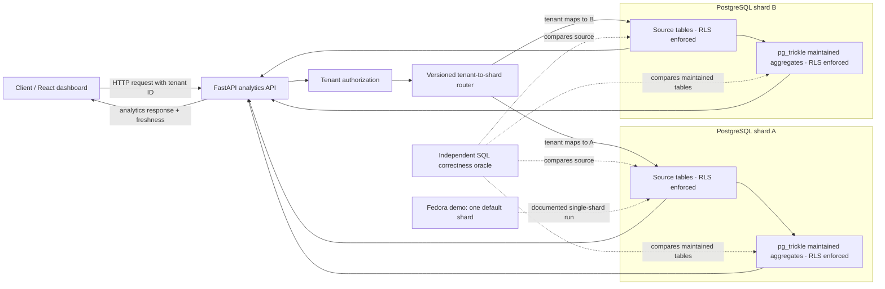
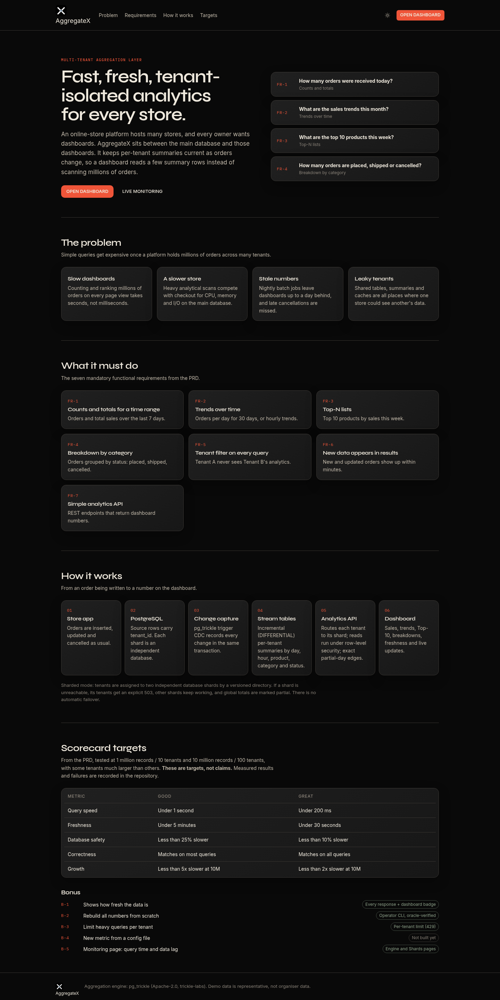
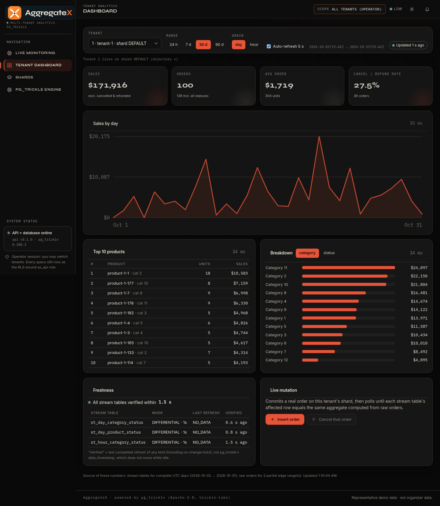
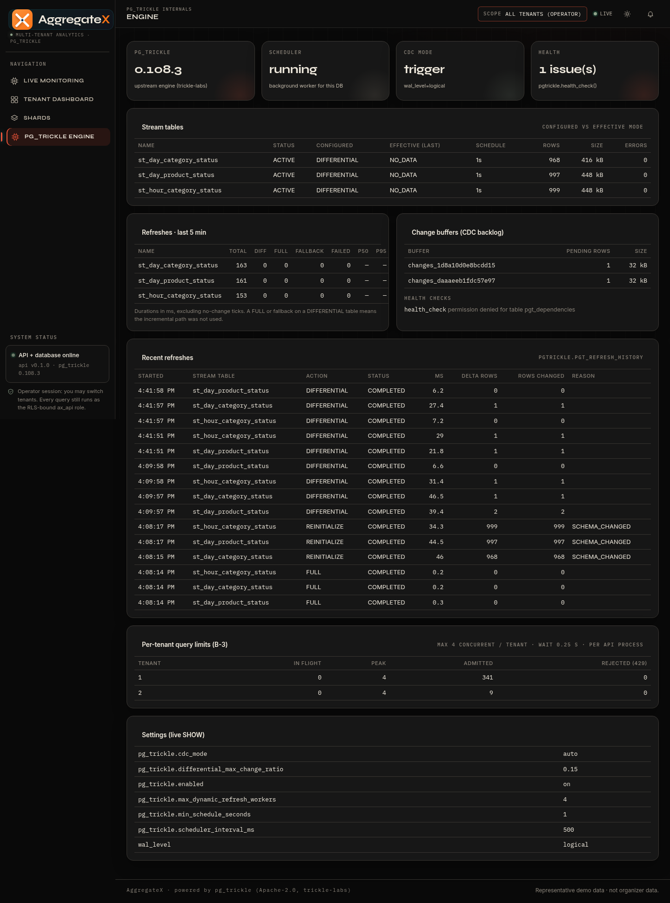
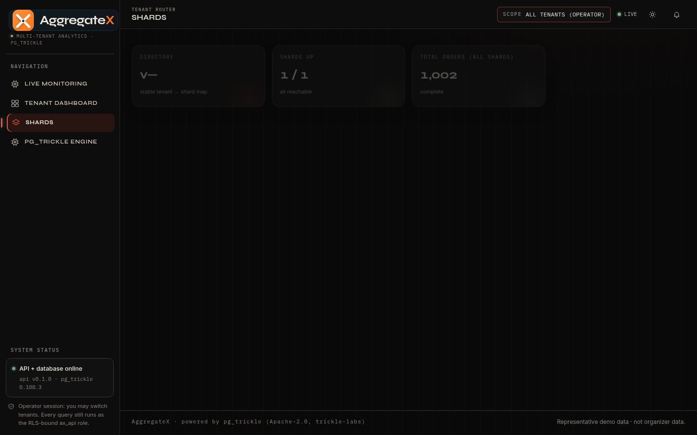
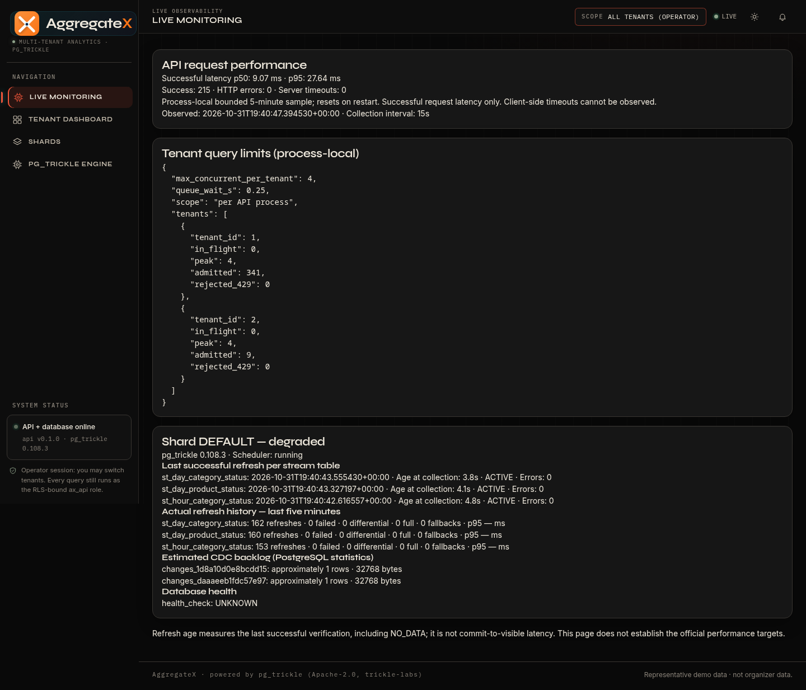
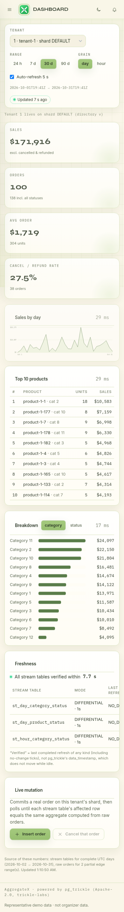

# AgrregateX

**Mitigata CyberForge 2026 · Fast Multi-Tenant Data Aggregation**

AgrregateX is a PostgreSQL-backed analytics prototype for multi-tenant order data. It keeps useful daily and hourly rollups available to a tenant-aware API and dashboard, so repeated analytics requests need not recompute every aggregate from the full transactional dataset. It combines incremental stream tables, tenant routing, row-level security, freshness reporting, and an independent SQL correctness oracle.

> **Honest status (2026-11-01):** representative Mac synthetic tests now include **1M/10 and 10M/100**: 10M measured 3,600 serial HTTP requests, with **71/72 scenario p95s under 200 ms and 72/72 under 1 second**, 50 requests per scenario. Matched stored-p95 median growth is **1.18×**, but one case exceeds the 5× growth threshold. **G4 correctness still FAILS** after incremental updates: Fedora has a ghost paid aggregate, and an isolated CDC trace shows the negative image lost before post-staging. An upstream Rust fix is only a draft (#58). The opt-in `raw_source` backend and mode-aware dashboard are merged **but not deployed or live Postgres/RLS-validated**. An approved single-host two-shard network-fault drill passed while browser live-write is still 13/14; G2 at higher write loads and G3 remain problematic. These are synthetic evidence, not official organizer acceptance or proof of post-mutation correctness.

## The problem

Commerce dashboards repeatedly ask for order totals, time trends, product rankings, and category or status breakdowns. Running each request as a fresh aggregate over a growing order table increases query work with data volume and competes with checkout and order writes for CPU, memory, disk bandwidth, and locks.

The problem becomes harder with many tenants: access must stay tenant-scoped, some tenants may be much larger than others, and orders continue to arrive or change while users expect correct and fresh answers. A fast result that leaks another tenant's rows or silently misses cancellations is not acceptable; a correct but stale result or a costly refresh can still harm the transactional database.

## Our solution

AgrregateX builds the application layer around **pg_trickle**, an upstream Apache-2.0 PostgreSQL incremental-view-maintenance extension. The upstream project supplies the stream-table maintenance engine; the AgrregateX work supplies the hackathon-specific order schema and rollups, tenant-aware authorization and routing, API and dashboard, test oracle, monitoring surfaces, and demo/acceptance tooling.

- PostgreSQL stores `ax.orders`, `ax.products`, and tenant metadata.
- Three `ax` stream tables maintain day/product/status, day/category/status, and hour/category/status aggregates with pg_trickle. Complete UTC buckets use rollups; partial range edges are read from the source table to preserve exact windows.
- FastAPI authorizes the tenant before routing a request. In authenticated mode each tenant query uses a transaction-local `ax.tenant_id`; forced row-level security protects source and stream rows as a database boundary too.
- The router maps each tenant to its owning PostgreSQL shard using a versioned directory. An unavailable shard returns an explicit 503; data is not silently read from another shard.
- React/Vite provides the dashboard, freshness display, shard overview, Engine diagnostics, and operator Monitoring page.
- A direct SQL oracle independently compares maintained aggregates with source-derived results. The three-table stream oracle uses exact missing/extra row comparisons; the API oracle compares query answers with direct SQL.

### Architecture

The application supports multiple independent PostgreSQL + pg_trickle shards. The two-shard diagram shows that supported topology. The **verified Fedora walkthrough is a separate historical single-shard deployment** named `default`; it does not claim two physical shards.



The configured two-shard topology and routing contract are in [`compose.sharded.yaml`](compose.sharded.yaml), [`sharding/directory.v1.json`](sharding/directory.v1.json), and [`app/axapi/db.py`](app/axapi/db.py). The existing Fedora verification report documents the actual one-shard instance and its limits.

## Implemented features

| Requirement | Implementation and evidence | Current qualification |
|---|---|---|
| FR-1: order counts and totals | Tenant/window summary API; totals use integer cents and separate sale statuses from cancelled/refunded statuses. | Available and exercised live; organizer revenue/status semantics remain unconfirmed. |
| FR-2: daily/hourly trends | `grain=day` or `grain=hour`; UTC bucket rollups with exact partial edges. | Both routes exercised; organizer timezone rules remain unconfirmed. |
| FR-3: Top-N products | Aggregates all qualifying products for the range before applying `limit`; stable product-ID tie-break. | Route exercised; organizer ranking definition remains unconfirmed. |
| FR-4: category/status breakdowns | `by=category` or `by=status`. | Both routes exercised; organizer's status/category definitions remain unconfirmed. |
| FR-5: tenant isolation | API checks identity before routing; transaction-local tenant scope and forced RLS. | Auth/RLS tests exist. The Fedora screenshots use an explicit operator bypass and are **not** a live isolation proof. |
| FR-6: incremental freshness | pg_trickle maintained stream tables plus completed-refresh freshness evidence in API/UI. | Point-in-time freshness works. Sustained-write commit-to-visible performance is not consistently within the Great target. |
| FR-7: analytics REST API | FastAPI routes listed below, plus OpenAPI at `/api/docs`. | Current Fedora GET smoke returned 200 for all checked endpoints. Availability is not a full correctness or performance qualification. |

### Bonus features

| Bonus | Status | Notes |
|---|---|---|
| B1 freshness indicator | **Partial** | Freshness is returned with analytics and shown in the UI. It reports last completed refresh, not a sustained-write latency guarantee. |
| B2 protected rebuild workflow | **Implemented, verified on a disposable stack** | Operator CLI reinitializes stream tables and requires exact oracle coverage. It is intentionally not a web endpoint and was not run on the preserved Fedora database. |
| B3 per-tenant concurrency limits | **Implemented, verified** | Per API process semaphore; rejects excess work with HTTP 429 and `Retry-After`. It is not a cluster-wide/global limit. |
| B4 config-driven metric | **Not implemented** | No metric registry that adds approved metrics from configuration. |
| B5 monitoring | **Partial** | Engine, Shards, and Monitoring show bounded operational data. Fedora Monitoring currently reports degraded/UNKNOWN because `ax_monitor` cannot read `pgtrickle.pgt_dependencies`; the UI preserves that warning. API latency counters are process-local and CDC backlog is estimated. |

## Technology stack

| Technology | Role |
|---|---|
| PostgreSQL 18 | Transactional source data, row-level security, and maintained aggregate tables. |
| pg_trickle 0.108.3 in the verified Fedora runtime | Upstream extension that incrementally maintains stream tables. The repository engine source may be a different patch version; see the evidence report. |
| Python 3.14 / FastAPI / psycopg 3 | Async HTTP API, tenant authorization, connection pools, tenant-to-shard routing, and bounded database calls. |
| React 19 / Vite 8 / Node 22 | Responsive client dashboard and static asset build. |
| Docker Compose | Optional isolated development deployment with two PostgreSQL shard services. It is not needed by the already-running Fedora demonstration. |
| SQL + Python test tooling | Independent aggregate oracle, API/oracle checks, smoke checks, and benchmark acceptance validation. |

## Screenshots

These were captured from the verified Fedora app run on 2026-11-01, not generated mockups. Data is representative synthetic demo data. The Monitoring view intentionally shows its actual degraded health-check state.

| Landing | Dashboard | Engine |
|---|---|---|
|  |  |  |

| Shards (one Fedora `default` shard) | Monitoring (degraded health check shown) | Mobile dashboard |
|---|---|---|
|  |  |  |

Additional desktop/mobile page captures and machine-readable smoke/browser results are in [`fedora_demo/evidence-20261101/`](fedora_demo/evidence-20261101/). The screenshots show an operator-mode local session; they do not establish production authentication behavior.

## Local setup and execution

### Existing Fedora demonstration

The verification report records the latest-main build served at **`http://127.0.0.1:8094/`** on the Fedora demo host. Loopback addresses work only on that machine; they are not public links. The process used the existing `round1-db` database at `127.0.0.1:25560`, PostgreSQL 18.6, and pg_trickle 0.108.3. It ran with `AX_AUTH_DISABLED=1` and `AX_ENABLE_DEMO_WRITES=0`; this operator bypass is strictly for a trusted localhost demo and does not prove tenant authentication. Do not expose it to a LAN or the Internet.

The verification used only read-only API/SQL checks. It did not run migrations, grant permissions, restart the database, seed data, or invoke write/rebuild endpoints. Monitoring remains degraded pending independent review of its separate permission repair. See [`fedora_demo/QUICKSTART.md`](fedora_demo/QUICKSTART.md), [`fedora_demo/JUDGE_WALKTHROUGH.md`](fedora_demo/JUDGE_WALKTHROUGH.md), and [`fedora_demo/LATEST_MAIN_VERIFICATION.md`](fedora_demo/LATEST_MAIN_VERIFICATION.md) before presenting.

If reproducing the frontend/backend against an **already initialized** local database, install the app and frontend dependencies, build the frontend, configure the existing database connection through environment variables, then run the provided launcher. The launcher binds to `127.0.0.1`, sets operator demo mode, and disables demo writes:

```bash
cd hackathon/frontend
npm ci
npm run build

cd ../app
# Set AX_DB_HOST, AX_DB_PORT, AX_DB_NAME and the existing role passwords
# from a local secret store. Do not put secrets in the repository.
AX_LOCAL_DEMO_PORT=8094 bash ./run_local_demo.sh
```

Only do this after verifying that the selected database is the intended existing demo database. If a port or database is already in use, stop and investigate; do not kill processes, initialize/migrate/reseed the database, or remove volumes to make the command work. This launcher requires the existing application roles and schema to be initialized already.

### Isolated disposable setup for new developers

This creates **new** containers and persistent volumes under a unique Compose project, two shard databases, and a local API. Use it only on a machine with enough memory/disk and after checking that the ports are free. It does not connect to the preserved Fedora database. The default dataset is a small representative 10,000 orders; no large benchmark is started.

Requirements: Docker or Podman with Docker Compose v2, Git, and enough free resources for the database images. No local Rust build is required; the container image includes PostgreSQL and pg_trickle, and the API image builds the React client.

```bash
cd hackathon
# Check that 18091, 25571 and 25572 are available before starting.
AX_API_PORT=18091 AX_SHARD_A_PORT=25571 AX_SHARD_B_PORT=25572 \
  docker compose -p ax-judge-dev -f compose.sharded.yaml up -d --build --wait
```

Open `http://127.0.0.1:18091/`. The sharded stack uses login mode by default; configure a unique local `AX_DEMO_PASSWORD` and database-role passwords in an untracked local environment file before sharing a machine. Never treat compose's local fallback credentials as suitable for public deployment. The demo users are `tenant<N>@demo.local` and `admin@demo.local`; all use the locally configured demo password. Do not enable operator bypass or expose the listener beyond loopback.

To stop only this named disposable stack while preserving its volumes:

```bash
docker compose -p ax-judge-dev -f compose.sharded.yaml down
```

This intentionally omits volume deletion. Inspect the project and its volumes before any separate cleanup; never run `down -v` against an existing environment. For topology details see [`compose.sharded.yaml`](compose.sharded.yaml) and [`sharding/directory.v1.json`](sharding/directory.v1.json).

## REST API

The API is documented by FastAPI at `/api/docs` and `/api/openapi.json`. Analytics routes require an authorized tenant identity in secure mode; operator routes require an operator identity. `from` and `to` accept ISO-8601 timestamps and define a half-open `[from, to)` window. If omitted, the API defaults to the most recent 30 days ending now. Results include source-range and freshness metadata.

| Method and route | Purpose / parameters |
|---|---|
| `GET /api/health` | API/database availability and pg_trickle version. |
| `GET /api/tenants` | Tenants visible to the signed-in identity. |
| `GET /api/tenants/{id}/summary?from=…&to=…` | Order counts, sales and status totals. |
| `GET /api/tenants/{id}/trends?from=…&to=…&grain=day\|hour` | Time trends; hourly windows are limited to 31 days. |
| `GET /api/tenants/{id}/top-products?from=…&to=…&limit=10` | Top products; `limit` is 1–50. |
| `GET /api/tenants/{id}/breakdown?from=…&to=…&by=status\|category` | Status or category breakdown. |
| `GET /api/tenants/{id}/freshness` | Completed refresh information for that tenant's shard. |
| `GET /api/shards` | Operator: shard reachability and source order totals. |
| `GET /api/engine?shard=a` | Operator: stream table status, effective modes, refresh history, buffers and health checks. `shard` is optional in single-shard mode. |
| `GET /api/monitoring` | Operator: bounded process-local request metrics, query limits and shard health. |
| `GET /api/limits` | Operator: per-process per-tenant concurrency counters. |
| `POST /api/tenants/{id}/live-write` | Optional demo insert/cancel; disabled on the verified Fedora run. **Not needed for read-only walkthrough.** |

Read-only examples:

```bash
curl --fail --max-time 4 http://127.0.0.1:18091/api/health
COOKIE_JAR="$(mktemp)"
curl --fail --max-time 4 -c "$COOKIE_JAR" \
  -H 'Content-Type: application/json' \
  -d "{\"email\":\"tenant1@demo.local\",\"password\":\"$AX_DEMO_PASSWORD\"}" \
  http://127.0.0.1:18091/api/auth/login
curl --fail --max-time 4 -b "$COOKIE_JAR" 'http://127.0.0.1:18091/api/tenants/1/summary'
curl --fail --max-time 4 -b "$COOKIE_JAR" 'http://127.0.0.1:18091/api/tenants/1/trends?grain=hour'
curl --fail --max-time 4 -b "$COOKIE_JAR" 'http://127.0.0.1:18091/api/tenants/1/breakdown?by=category'
rm -f "$COOKIE_JAR"
```

This example assumes `AX_DEMO_PASSWORD` is set in the local shell to the password configured for this disposable stack. Tenant authorization is checked before shard routing; a request to a different tenant is denied. An unavailable owning shard returns 503 rather than a cross-shard fallback.

## Performance and correctness scorecard

This is a **dated evidence summary (2026-11-01)**, not an official organizer certification. All measured load data below are **representative synthetic** orders, on specified single-host setups. Raw data and failures are intentionally preserved. The official benchmark shape is 1M orders / 10 tenants and 10M / 100 tenants; organizer generator/schema compatibility is still unverified.

| Goal | Good / Great PRD threshold | Current measured evidence | Verdict |
|---|---|---|---|
| G1 HTTP latency | <1 s / <200 ms | Mac **1M/10 representative synthetic**: 3,600 serial requests, **72/72** scenarios p95 <200 ms, worst **60.8 ms**; with 5 writes/s, 1,440 requests and worst **81.7 ms**. Mac **10M/100 synthetic**: **3,600 requests**, 72 scenarios × 50, zero recorded errors, **71/72 p95 <200 ms**, **72/72 p95 <1 s**; worst **240.56 ms** (largest tenant, 90d top-products). | **10M Good on stored p95s; one scenario misses Great. NOT official acceptance**: only 50 requests/scenario, no organizer data, raw per-request timings or concurrent clients. |
| G2 commit-to-visible | <5 min / <30 s | Mac 1M at 5 writes/s: **8 probes**, 0 timeouts, median **18.7 s**, maximum **24.0 s**. A separate **10k / 200 TPS** experiment: **18/20 probes timed out beyond 30 s**, and 107 FULL fallbacks were observed. | Meets the Great threshold in the *sampled low-rate* 1M run; **fails Great** in the measured heavier-write test. No general G2 PASS. |
| G3 OLTP safety | <25% / <10% slowdown | Matched 10k five-pair A/B/C experiment at 200 offered TPS and 20 HTTP requests/s reports median B-vs-A throughput **+0.7%**, but host freezes invalidate a decisive p95 result; maintenance arm reports significant tail-latency impact. Earlier unbounded experiments had large regressions. | **INCOMPLETE / confounded**; no G3 PASS. |
| G4 correctness | Most / all answers match source | Mac 1M before writer: API/source **225 checks, 0 mismatches**; initial three-table oracle 0/0. **After writes** product stream had **16 missing / 31 extra groups** (+33 paid orders); other streams 0/0. Fedora 1,002-row demo has **persistent 0 missing / 1 extra paid group** with incorrect summary/Top-N/status. Approved **82-order pinned-runtime CDC trace** observes raw `I paid, D paid, I cancelled` but staged `I paid, I cancelled` and product oracle 0/1; joined oracles 0/0. | **FAIL. Staging loss observed**; reducer-vs-visibility inferred. Diagnostic [#50](https://github.com/surajgojanur/AgrregateX/issues/50) completed; follow-on fix [#54](https://github.com/surajgojanur/AgrregateX/issues/54) open. |
| G5 growth | 10M/1M p95 ratio <5× / <2× | [Synthetic 1M/10 and 10M/100 evidence](integration/scale/results/REPORT-10m.md): 72 scenario matches by tenant **size rank**; stored-p95 median ratio **1.18×**, **66/72 <2×**, **71/72 <5×**, worst **5.18×**. Largest tenant's order count grew ~5.7×. | **Measured synthetic comparison, not official PASS**: one <5× miss, 50 samples/scenario, missing raw timings and matched organizer provenance. |

**Source evidence:** [1M synthetic report](integration/scale/results/REPORT-1m.md), [10M synthetic report](integration/scale/results/REPORT-10m.md), [independent evidence arithmetic audit](benchmark/evidence_review/EVIDENCE_AUDIT.md), [matched G3 experiment](integration/g3/results/10k-o200-r20-matched/REPORT.md), [Fedora G4 forensics](benchmark/results/issue31/20261101T2100Z-forensics/REPORT.md), [source-level hypothesis](benchmark/results/issue31/20261101T2110Z-root-cause/PROPOSAL.md), [prepared but unexecuted runtime protocol](benchmark/results/issue31/20261101T2137Z-controlled-prep/RUNTIME_REPRO_REPORT.md), the [controlled runtime G4 report](integration/g4_trace/REPORT.md), the [approved live two-shard network-fault log](sharding/results/partition-20261031T231534Z.txt), and [Issue #31](https://github.com/surajgojanur/AgrregateX/issues/31).

**Correctness is a release/judge blocker.** The approved runtime trace confirms a lost negative image between raw CDC and post-staging, not the exact internal reducer substep, and does not explain the earlier Mac paid-only variant. No Rust fix, FULL-mode mitigation, raw-source activation, or existing-data repair has been deployed. **Merged opt-in backend mode:** `AX_ANALYTICS_READ_MODE=raw_source` (default `rollup`) computes all four analytics families from source tables using tenant-scoped `ax_api` transactions; it has 55 reported *offline* tests, no approved live PostgreSQL verification, and the mode-aware React dashboard is now **merged** ([PR #59](https://github.com/surajgojanur/AgrregateX/pull/59), 24 frontend tests and mocked Chromium QA). **Neither component is deployed or real-PostgreSQL/RLS/latency validated**. Do not enable it on the judge demo before approved live auth/RLS/source-oracle/performance testing. Do not interpret a healthy refresh timestamp as a correctness guarantee. Existing experimental scripts with DML or writer stop/start are **disposable-test-only**.


## Testing

The verification report [`fedora_demo/LATEST_MAIN_VERIFICATION.md`](fedora_demo/LATEST_MAIN_VERIFICATION.md) records the exact environment and commands. On the 2026-11-01 Fedora latest-main run:

- Backend Python suite: **36 passed**; unit/mock and API contract coverage, not a full workload acceptance run.
- Fedora demo helper suite: **9 passed**.
- Frontend Node tests: **3 passed**; ESLint and production build passed.
- Safe GET smoke: **12/12** endpoint checks passed with bounded timeouts; no writes were sent.
- Browser QA: desktop 1440 px and mobile 390 px, dashboard and navigation/reload, theme and range controls, Shards, Engine, Monitoring; no captured page/console errors.
- Live DB check: existing PostgreSQL was read-only. Monitoring showed the known permission error; migration 003 was not applied.

Unit/mock tests validate application logic but are not full PostgreSQL, security, performance, or organizer-data acceptance. Reproduce the bounded Fedora smoke from the repository root when the service is already running:

```bash
python3 hackathon/fedora_demo/smoke.py \
  --base-url http://127.0.0.1:8094 --tenant-id 1
```

The smoke script is GET-only and restricts requests to loopback. Never run a live-write or rebuild test against the preserved Fedora database.

## Known limitations

- **Critical G4 correctness defect remains unresolved:** the CDC staging-loss trace is complete ([#50](https://github.com/surajgojanur/AgrregateX/issues/50) closed as diagnostics), but the engine correction and regression proof remain [#54](https://github.com/surajgojanur/AgrregateX/issues/54). Fedora's ghost paid group still makes summary/Top-N/status wrong for the affected tenant/date. Do not present these figures as correct or demonstrate cancellation as a verified success.
- The Fedora Monitoring page remains degraded because `ax_monitor` cannot read `pgtrickle.pgt_dependencies`. The proposed migration 003 is a separate, unapplied review item; no grant is implied by these docs.
- Scheduled freshness can fall behind under heavy writes. Small idle refresh ages do not prove commit-to-visible performance at load.
- Earlier G3 experiments recorded database throughput regressions; the full comparable randomized experiment is incomplete.
- A representative synthetic **10M/100** single-database run and **72 matched synthetic G5 ratios** were recorded and audited; **official organizer-data G1/G5 acceptance is incomplete** (50 rather than 200+ samples/scenario, no raw timing samples, one growth case above 5×). G2/G3 and post-mutation G4 at 10M remain untested.
- Organizer data schema, status/revenue semantics, time-zone rules, generator, and skew compatibility remain unverified.
- The Fedora screenshots and live walkthrough show one `default` shard. A separate **approved Mac two-shard network-fault drill PASSED**: shard A failed closed with 503, shard B remained available, network restore and exact per-shard oracles passed. It is **single-host partition evidence**, not HA/failover, not the Fedora topology, and not a fix for remaining shard-B browser live-write timeout (13/14 QA) or ghost-paid drift.
- The Fedora operator-mode run disables application login for a loopback presentation. Use secure login mode for tenant-isolation demonstrations.

## Demo and evaluation

Use the [3–5 minute judge walkthrough](fedora_demo/JUDGE_WALKTHROUGH.md). Suggested sequence:

1. Landing page and problem framing.
2. Dashboard UI and the source-backed verification process; **disclose that some stored product rollups are known incorrect**. Do not represent the affected KPI/Top-N figures as source-verified.
3. Switch tenants and show the tenant-scoped results.
4. Show freshness and the three stream tables/effective refresh modes.
5. Show Shards and state clearly whether this is the one-shard Fedora or separate two-shard environment.
6. Show Monitoring, including its honest degraded state.
7. Close with the oracle, scorecard evidence, and limitations.

The demo database is read-only for this Fedora walkthrough. Do not press live insert/cancel controls or run rebuild commands against it. The screenshot evidence predates the detailed G4 investigation and must not be represented as a clean end-to-end correctness proof.

## Credits and licensing

AgrregateX is built on **pg_trickle**, an upstream PostgreSQL extension from trickle-labs, distributed under the Apache License 2.0. The incremental-view engine is upstream work; AgrregateX's contribution is the multi-tenant order aggregation application, schema/rollup definitions, API and routing, RLS configuration, dashboard, correctness/acceptance tooling, and hackathon demo integration. See the root [`README.md`](../README.md) and [`LICENSE`](../LICENSE) for upstream project information and licensing. Do not attribute the upstream Rust engine to the AgrregateX team.
