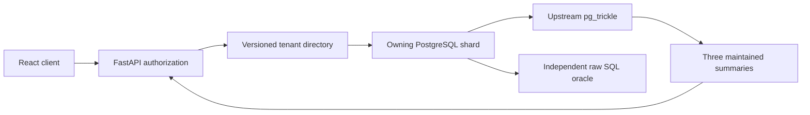

> FINAL REHEARSAL UPDATE — 2026-11-01, HEAD daefdd657339ca9e44805283108610a44ee50009: localhost8093 restored against preserved round1-db. HTTP verified, browser unavailable. Fresh oracle: product/day/status 0 missing, 1 extra; other two 0/0. Current correctness NOT READY. See FINAL_READINESS.md; this update supersedes historical availability/count/readiness statements below.

> Audit revision: `daefdd657339ca9e44805283108610a44ee50009`; 2026-11-01. Recorded evidence retains its own earlier provenance. Current localhost:8093 unavailable. No live feature certified ready.

# Screen sequence

Default every screen: READY WITH RECORDED EVIDENCE; live UI and database: NOT READY — USE FALLBACK. No current live screen passed.

| Screen | Display and action | Proof / requirement |
|---|---|---|
|01|E1 landing-desktop.png; conditional URL http://127.0.0.1:8093/ → OPEN DASHBOARD|Problem|
|02|E1 analytics-desktop.png; conditional /app#/dashboard; tenant 1 → 2, change date range within populated dates, daily → hourly, category → status; confirm responses actually change before rehearsal signoff|FR1–4/7|
|03|Diagram below plus SQL 10_stream_tables.sql|E8 architecture|
|04|auth.py authorize_tenant, db.py transaction context, 20_security.sql; E2 recorded operator 403|FR5; not a fresh cross-tenant login proof|
|05|E4 log; directory.v1.json; E1 shards-desktop.png labelled one-shard Fedora|Routing/failure|
|06|10_stream_tables.sql; E1 recorded source counts 406 tenant1/201 tenant2|Actual SQL; no fresh database claim|
|07|E2 oracle 0/0 both shards; E3 200 comparisons|Bounded correctness|
|08|E5 lag measurements; E1 freshness screenshot|B1; distinguish refresh age|
|09|E1 monitoring-desktop.png plus E7 newer status and benchmark document|B5 partial, database safety|
|10|Diagram, attribution, three roadmap gates|Engineering contribution|

Use one laptop with browser and local Markdown/evidence viewer on adjacent workspaces. Two displays: product left, proof right; no dependence on a second laptop. Pre-open screenshots offline, enlarge terminal to 22–26pt, hide notifications and credentials. Do not open .env, .secrets.json or shell history. No migration, rebuild, partition, benchmark or live-write actions on stage.
