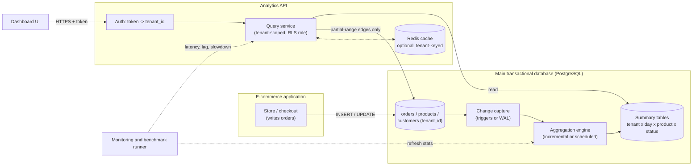
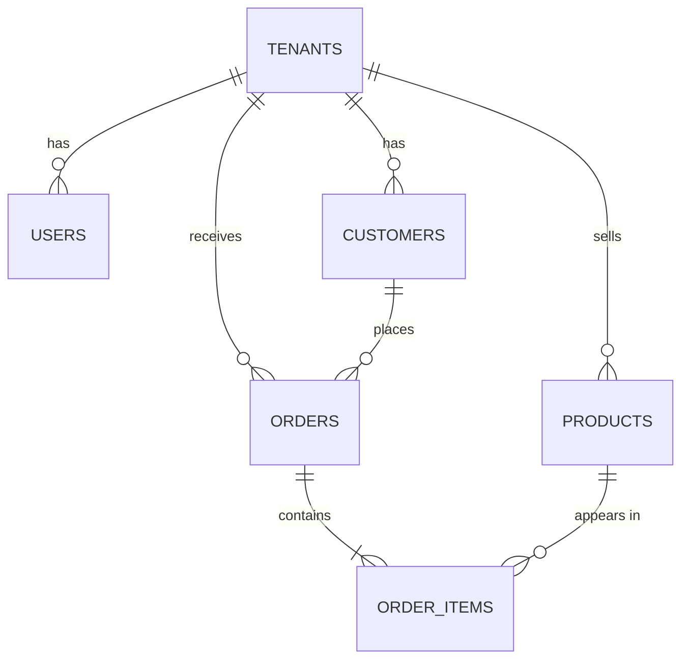

# Problem Statement Documentation: Multi-Tenant Aggregation Layer

> **Status:** planning reference, the single source of truth for understanding the problem.
> **Prepared:** 2026-10-31
>
> **Source of truth and an important caveat.** The authoritative source is the organiser's PRD, *"Multi-Tenant Aggregation
> Layer"* (three images). **The images were not attached to the session in which this document was written.** Every
> requirement and number marked **[PRD]** below was taken from the team's written transcription of those images: the
> problem text, FR-1..FR-7, dataset sizes, scorecard values, B-1..B-5 and the suggested technologies. Before relying on
> this document, re-check every **[PRD]** item against the original images. If anything differs, the images win.
>
> **Labels used throughout**
>
> | Label | Meaning |
> |---|---|
> | **[PRD]** | Official requirement or value from the PRD |
> | **[PRD-suggested]** | A technology the PRD *suggests*. Not mandatory. |
> | **[PROPOSAL]** | Our design idea. Not an official requirement. |
> | **[UNKNOWN]** | Information the PRD does not give us; see §16 |
> | **[EVALUATING]** | A technology under evaluation, not yet proven suitable |

---

## Table of contents
1. [Executive Summary](#1-executive-summary)
2. [Background and Problem Context](#2-background-and-problem-context)
3. [Problem Analysis](#3-problem-analysis)
4. [Functional Requirements](#4-functional-requirements)
5. [Non-Functional Requirements](#5-non-functional-requirements)
6. [Official Performance Targets](#6-official-performance-targets)
7. [Bonus Requirements](#7-bonus-requirements)
8. [Suggested Technologies](#8-suggested-technologies)
9. [Technical Concepts We Must Understand](#9-technical-concepts-we-must-understand)
10. [Proposed Solution Architecture](#10-proposed-solution-architecture)
11. [pg_trickle Technology Evaluation](#11-pg_trickle-technology-evaluation)
12. [Data Model and Database Design](#12-data-model-and-database-design)
13. [API Design](#13-api-design)
14. [Correctness and Reconciliation Strategy](#14-correctness-and-reconciliation-strategy)
15. [Performance Benchmarking Strategy](#15-performance-benchmarking-strategy)
16. [Risks, Unknowns and Assumptions](#16-risks-unknowns-and-assumptions)
17. [Development Roadmap](#17-development-roadmap)
18. [Final Evaluation Checklist](#18-final-evaluation-checklist)
19. [Glossary](#19-glossary)

---

## 1. Executive Summary

### The problem [PRD]
An online-store platform, similar to Shopify, hosts many independent stores. Each store owner is a **tenant**, and each tenant has
its own **orders, products and customers**. Store owners want dashboard analytics such as:

- How many orders were received today?
- What are the sales trends this month?
- What are the top 10 products this week?
- How many orders are placed, shipped, or cancelled?

With millions of records, answering these questions with simple queries on the main database becomes **expensive**. It is slow
for the dashboard and it competes with the store's normal work (checkout, order updates).

### What we must build [PRD]
An **aggregation layer** that sits **between the main database and the dashboards**. It must be:

| Property | Meaning |
|---|---|
| Fast | Dashboard queries answer quickly |
| Fresh | New and updated orders appear within minutes (great target: seconds) |
| Correct | Answers match what a direct query on the source data returns |
| Tenant-isolated | A tenant only ever sees its own analytics |
| Scalable | Keeps working as data grows from 1M to 10M records and as tenant sizes become uneven |

It must also not slow down the main application's normal reads and writes ("database safety").

### Purpose of a multi-tenant aggregation layer
Pre-compute, and keep current, the numbers that dashboards need, separately from raw order rows. A dashboard then reads a small,
tenant-scoped summary instead of scanning millions of orders.

### Expected outcome
A working system that:
- answers the four mandatory query types (FR-1..FR-4) through a simple REST API (FR-7), with tenant filtering (FR-5) and fresh data (FR-6);
- is measured against the official scorecard (§6) at 1M/10 and 10M/100;
- optionally delivers the bonus features B-1..B-5.

No target is claimed as achieved in this document.

---

## 2. Background and Problem Context

| Concept | Plain explanation | Example |
|---|---|---|
| **Online-store platform** | One software service that many shops run on. The platform owns the servers and database. | "Asha's Shoes" and "Ravi's Electronics" both sell through the same platform |
| **Tenant** | One customer of the platform (one store owner) whose data must be kept separate | Asha's Shoes = tenant 17 |
| **Multi-tenant architecture** | Many tenants share the same application, and often the same database, while staying logically separate | One `orders` table holds every store's orders, each row tagged with `tenant_id` |
| **Dashboard analytics** | Summarised numbers and charts about a store's activity | "142 orders today, ₹3.2 lakh sales, top product: running shoes" |

### Why queries get expensive with millions of records
To count today's orders for a store, the database must find and read every matching row. To find the **top 10 products this
week**, it must read every order line for the week, group by product, sum, and sort. With 10M orders, a busy store may have
hundreds of thousands of matching rows. Each dashboard refresh repeats all of that work, for every store owner who opens a
dashboard.

### Why analytics slow down normal reads and writes
The main database has finite CPU, memory, disk bandwidth and locks. A large analytical scan:
- uses CPU and I/O that checkout queries also need;
- pushes frequently used data out of memory (cache eviction);
- can hold resources long enough to queue short transactions.

Customers then feel it as a slower checkout. The PRD's **database safety** metric measures exactly this.

### Why nightly aggregation jobs are not enough
A nightly batch job produces numbers that are up to 24 hours old. The PRD requires new data to appear **within a few minutes**
(FR-6). Its scorecard sets **Good < 5 minutes** and **Great < 30 seconds** (§6). A nightly job also runs a large burst of work
and cannot easily correct late updates, such as an order cancelled the next morning.

### Why a dedicated aggregation layer
It separates two very different workloads:
- **OLTP (transactions):** many small, fast reads and writes. This is the store working.
- **Analytics:** fewer, larger summarising reads. This is the dashboard.

The layer maintains summaries incrementally, or on a short schedule, so dashboards read small summaries and the main tables stay fast.

---

## 3. Problem Analysis

### 3.1 Slow dashboard queries
- **What:** queries such as "sales per day this month" scan and group many rows.
- **Why:** the cost grows with the number of rows per tenant and the length of the time range.
- **Impact:** slow dashboards (seconds instead of milliseconds) and a poor user experience.
- **Must achieve:** **[PRD]** query speed of < 1 s (good) or < 200 ms (great), at 10M records.

### 3.2 Heavy analytics affecting the main database
- **What:** analytical scans compete with checkout and order traffic.
- **Why:** shared CPU, I/O, memory and locks.
- **Impact:** normal application queries slow down.
- **Must achieve:** **[PRD]** normal queries no more than 25% slower (good) or 10% slower (great) while dashboards are in use.

### 3.3 Data freshness
- **What:** summaries lag behind the source data.
- **Why:** pre-computed numbers must be updated after every insert, update or cancellation.
- **Impact:** owners see stale numbers, such as a cancelled order still counted as a sale.
- **Must achieve:** **[PRD]** new and updated orders appear within a few minutes (FR-6). The scorecard sets < 5 minutes (good) and < 30 s (great).

### 3.4 Tenant data isolation
- **What:** one tenant must never see another tenant's numbers.
- **Why it is hard:** shared tables, shared summary tables, caches, and API parameters are all places where a missing `tenant_id` filter leaks data.
- **Impact:** a privacy and security breach. This is the most serious possible failure.
- **Must achieve:** **[PRD]** FR-5, a tenant filter on every query.

### 3.5 Analytical correctness
- **What:** a summary must equal what a direct query on the source returns.
- **Why it is hard:** updates and cancellations must *change* earlier numbers, not just add to them. Duplicate events, time-zone boundaries and partial time windows all cause subtle errors.
- **Impact:** wrong business decisions and lost trust.
- **Must achieve:** **[PRD]** results match on most queries (good) or on all queries (great).

### 3.6 Scalability and uneven tenant workloads
- **What:** data grows tenfold (1M → 10M), and some tenants are much larger than others **[PRD]**.
- **Why it is hard:** a design that is fine for a small tenant can be slow for a giant one, and one heavy tenant can starve the others.
- **Impact:** latency grows with data size, and the experience is unfair across tenants.
- **Must achieve:** **[PRD]** less than 5× slower at 10M (good) or less than 2× (great). B-3 (per-tenant limits on heavy queries) addresses fairness.

---

## 4. Functional Requirements

All seven are **mandatory [PRD]**.

| ID | Requirement [PRD] | PRD example | Notes / open questions |
|---|---|---|---|
| **FR-1** | Counts and totals for a time range | Number of orders and total sales over the last 7 days | "Sales" definition is **[UNKNOWN]**: does it exclude cancelled orders? Gross or net? |
| **FR-2** | Trends over time | Orders per day for the last 30 days, or hourly trends | Bucket timezone is **[UNKNOWN]** |
| **FR-3** | Top-N lists | Top 10 products by sales this week | Ranking metric (revenue or units) and tie-breaking are **[UNKNOWN]** |
| **FR-4** | Breakdown by category | Orders grouped by status: placed, shipped, cancelled | The full status list is **[UNKNOWN]** until the organiser schema is known |
| **FR-5** | Tenant filter on every query | Tenant A must never see Tenant B's analytics | Applies to the API, summaries **and** caches |
| **FR-6** | New data appears in results | New and updated orders appear within a few minutes | Includes **updates** (for example cancellation), not only inserts |
| **FR-7** | Simple analytics API | REST endpoints to retrieve dashboard analytics | Endpoint shapes are **our proposal** (§13) |

### Example request and response [PROPOSAL, not an official specification]

```http
GET /api/tenants/17/summary?from=2026-10-24T00:00:00Z&to=2026-10-31T00:00:00Z
Authorization: Bearer <token for tenant 17>
```
```json
{
  "tenant_id": 17,
  "from": "2026-10-24T00:00:00Z",
  "to": "2026-10-31T00:00:00Z",
  "orders": 1412,
  "sales_cents": 32019950,
  "by_status": { "placed": 120, "shipped": 1210, "cancelled": 82 },
  "data_updated_at": "2026-10-31T09:59:41Z"
}
```

---

## 5. Non-Functional Requirements

| NFR | What it means | Why it matters |
|---|---|---|
| **Performance** | Dashboard queries return quickly over HTTP, not just inside the database | Owners open dashboards often; slow pages feel broken. Scored as "query speed" |
| **Data freshness** | Time from a change being committed in the main DB to that change being visible on the dashboard | Stale numbers are misleading. Scored as "freshness" |
| **Database safety** | Normal app queries are not noticeably slowed by the analytics system | Protects checkout and revenue. Scored as "database safety" |
| **Tenant isolation** | No cross-tenant data is ever visible | Security and privacy (FR-5) |
| **Correctness** | Summaries equal direct source queries | Trust. Scored as "correctness" |
| **Scalability** | Latency stays stable as data grows and tenants become uneven | Platforms grow. Scored as "growth" |

---

## 6. Official Performance Targets

### Dataset sizes [PRD]

| Test | Records | Tenants |
|---|---|---|
| Small test | 1 million | 10 |
| Main test | 10 million | 100 |

**[PRD]** Some tenants have **much larger datasets than others** (skewed distribution).

### Performance scorecard [PRD]

| Metric | Good target | Great target |
|---|---|---|
| Query speed | Under 1 second | Under 200 ms |
| Freshness | Under 5 minutes | Under 30 seconds |
| Database safety | Less than 25% slower | Less than 10% slower |
| Correctness | Matches on most queries | Matches on all queries |
| Growth | Less than 5x slower at 10M | Less than 2x slower at 10M |

> None of these targets has been achieved or verified yet. Each needs benchmark evidence (§15).

### How each metric should be measured [PROPOSAL]

| Metric | Measurement method |
|---|---|
| **Query speed** | End-to-end **HTTP** latency for each of the four query types. Cover small, medium and largest tenants and short and long ranges. Report p50 / p95 / p99 / max and the error count. |
| **Freshness** | For inserts, updates and cancellations: record the commit time in the main DB, poll the API until the change is visible, and report each lag and the worst case. |
| **Database safety** | Run the same normal-app workload (reads + writes) twice on the same hardware: (a) aggregation system off or idle, (b) with dashboard load. Compare latency and throughput. Slowdown % = (b − a) / a. Use repeated, randomised runs. |
| **Correctness** | For every API answer, run the equivalent direct SQL against source tables on a consistent snapshot. Count mismatches. |
| **Growth** | Same queries, same relative ranges and tenant roles, same hardware. Ratio = latency at 10M ÷ latency at 1M. |

---

## 7. Bonus Requirements

All are **optional [PRD]**. They must never displace the mandatory requirements.

| ID | Bonus [PRD] | Implementation idea [PROPOSAL] | Benefit |
|---|---|---|---|
| **B-1** | Response shows how fresh the data is, e.g. "Updated 20 seconds ago" | Include `data_updated_at` (time of last successful summary refresh) in every response; the UI renders "Updated N s ago" | Owners know whether to trust the numbers |
| **B-2** | Rebuild all numbers from scratch if something goes wrong | Protected admin command that recomputes every summary from source tables, then verifies against direct SQL | Recovery from bugs or corruption |
| **B-3** | Limit how many heavy queries one tenant can run simultaneously | Per-tenant concurrency limit (semaphore); excess requests get `429 Too Many Requests` | One heavy tenant cannot starve the others |
| **B-4** | Add a new metric by editing a configuration file rather than code | A metric registry (YAML/JSON) listing an allow-listed aggregate, dimension and filter; the engine generates the summary | Faster product iteration; no arbitrary SQL from config |
| **B-5** | A simple monitoring page showing query time and data lag | A page showing API latency percentiles, summary lag, refresh failures and backlog | Operators see problems early |

---

## 8. Suggested Technologies

### Mandatory vs suggested vs optional

| Category | Items |
|---|---|
| **Official mandatory** | FR-1..FR-7, the scorecard metrics, and the datasets (1M/10, 10M/100, skewed) |
| **Suggested by the PRD (not mandatory)** | See the table below |
| **Optional architectural choices (ours)** | pg_trickle (§11), the specific API shapes (§13), RLS, JWT, and so on |

| Role | Suggested technology [PRD-suggested] |
|---|---|
| Main database | PostgreSQL **or** MongoDB |
| Caching | Redis |
| Pre-computed numbers | Summary tables (SQL) or summary collections (MongoDB) |
| Keeping summaries updated | Cron jobs, change streams, or Kafka |
| Optional separate analytics store | ClickHouse or DuckDB |

No suggested technology is mandatory. Pick the simplest option that passes the scorecard.

---

## 9. Technical Concepts We Must Understand

Each entry gives a definition, an analogy, a technical explanation, an example from this problem, and why it matters.

### 9.1 Database indexing
- **Definition:** a lookup structure that finds rows without reading the whole table.
- **Analogy:** a book's index. You go straight to page 212 instead of reading every page.
- **Technical:** usually a B-tree on one or more columns. A query filtering on those columns can jump to the matching rows.
- **Example:** an index on `orders(created_at)` lets "orders today" read only today's rows.
- **Why it matters:** it is the first and cheapest speed-up, though not enough alone for large aggregations.

### 9.2 Composite indexes
- **Definition:** one index over several columns, in a fixed order.
- **Analogy:** a phone book sorted by surname, then first name.
- **Technical:** `(tenant_id, created_at)` serves "tenant X, between two times". Column order matters: the leftmost column must be filtered.
```sql
CREATE INDEX orders_tenant_created_idx ON orders (tenant_id, created_at);
```
- **Example:** tenant 17's orders from last week sit together in the index.
- **Why it matters:** every query is tenant-scoped (FR-5), so `tenant_id` should lead most indexes.

### 9.3 Multi-tenancy
- **Definition:** one system serving many customers whose data is kept separate.
- **Analogy:** an apartment building with shared walls and plumbing, but every flat has its own lock.
- **Technical:** the three common models are a shared table with `tenant_id`, a schema per tenant, or a database per tenant.
- **Example:** the PRD says each tenant's data is in "their" database, while datasets are given as N records across M tenants. Which model is meant is **[UNKNOWN]**.
- **Why it matters:** the model changes how isolation, indexing and scaling work.

### 9.4 Tenant isolation
- **Definition:** a guarantee that a tenant can only reach its own data.
- **Analogy:** a bank teller can only open your account after verifying your identity.
- **Technical:** enforced in layers. Authentication tells us who the tenant is; the API checks the requested tenant; the database filters rows (for example with RLS); caches use tenant-scoped keys.
- **Example:** `GET /tenants/18/summary` with tenant 17's token must be refused.
- **Why it matters:** FR-5; a leak is the worst possible failure.

### 9.5 JWT authentication and tenant identification
- **Definition:** a JSON Web Token is a signed token that carries claims, such as `tenant_id`.
- **Analogy:** a tamper-evident wristband at an event.
- **Technical:** the server verifies the signature and reads `tenant_id` from the token, **never** from an unverified request parameter.
- **Example:** the token claims `{"sub":"owner@asha","tenant_id":17}`, so the API only serves tenant 17.
- **Why it matters:** it gives every query a trustworthy tenant identity.

### 9.6 PostgreSQL Row-Level Security (RLS)
- **Definition:** database rules that filter which rows a role may see.
- **Analogy:** a librarian who hands you only the files with your name on them, whatever you ask for.
- **Technical:**
```sql
ALTER TABLE orders ENABLE ROW LEVEL SECURITY;
ALTER TABLE orders FORCE ROW LEVEL SECURITY;
CREATE POLICY tenant_read ON orders FOR SELECT TO analytics_api
  USING (tenant_id = current_setting('app.tenant_id', true)::int);
-- per request, inside a transaction:
SELECT set_config('app.tenant_id', '17', true);
```
- **Example:** even a buggy query without `WHERE tenant_id = 17` returns only tenant 17's rows.
- **Why it matters:** defence in depth. RLS must also be applied to **summary tables**, not only source tables.

### 9.7 Database query optimisation
- **Definition:** making a query do less work for the same answer.
- **Analogy:** taking the motorway instead of every side street.
- **Technical:** use `EXPLAIN (ANALYZE, BUFFERS)` to see the plan, add the right indexes, pre-aggregate, avoid functions on indexed columns, and limit returned rows.
- **Example:** replacing a 10M-row scan with a read of 30 daily summary rows.
- **Why it matters:** query speed and database safety.

### 9.8 Sequential scans vs index scans
- **Definition:** a sequential scan reads the whole table; an index scan reads only the matching entries.
- **Analogy:** reading the whole book versus jumping from the index.
- **Technical:** the planner chooses based on statistics. For a large fraction of a table, a sequential scan may be cheaper.
```sql
EXPLAIN ANALYZE SELECT count(*) FROM orders
 WHERE tenant_id = 17 AND created_at >= now() - interval '1 day';
```
- **Example:** if the plan shows `Seq Scan on orders`, the composite index is missing or not usable.
- **Why it matters:** this is how we diagnose slow queries.

### 9.9 Aggregation and pre-computation
- **Definition:** computing totals in advance and storing them.
- **Analogy:** a shop keeping a running daily till total instead of re-counting every receipt.
- **Technical:** keep summary rows keyed by `(tenant_id, day, …)` with counts and sums, and answer queries by summing summary rows.
- **Example:** "sales last 30 days" becomes a sum of ≤ 30 daily rows instead of thousands of orders.
- **Why it matters:** it is the core of the aggregation layer.

### 9.10 Materialised views
- **Definition:** a stored result of a query that can be refreshed.
- **Analogy:** a printed report you reprint when the data changes.
- **Technical:** PostgreSQL `REFRESH MATERIALIZED VIEW` **recomputes the whole result**. `CONCURRENTLY` avoids blocking readers, but the refresh is still full.
- **Example:** a daily-sales view refreshed every 5 minutes re-scans every order on each refresh.
- **Why it matters:** a simple baseline, but at 10M records a full refresh is costly for freshness and database safety.

### 9.11 Incremental View Maintenance (IVM)
- **Definition:** updating a stored result by applying only the *changes* since the last update.
- **Analogy:** adding today's receipts to the running total instead of re-adding the whole year.
- **Technical:** for `COUNT` and `SUM`, an inserted row adds its value, a deleted row subtracts it, and an update is a delete plus an insert.
- **Example:** an order cancelled from "shipped" moves its count from the shipped bucket to the cancelled bucket.
- **Why it matters:** it can give fresh summaries without full recomputation. pg_trickle (§11) implements IVM.

### 9.12 Change Data Capture (CDC)
- **Definition:** recording every insert, update and delete so other systems can react.
- **Analogy:** a security camera log of everything that changed.
- **Technical:** captured with triggers, the database's write-ahead log (logical decoding), or an event stream (for example Kafka, or MongoDB change streams).
- **Example:** an order status change is captured and applied to the status summary.
- **Why it matters:** it drives freshness. Each method has a different write cost.

### 9.13 Caching
- **Definition:** keeping recent answers in fast memory.
- **Analogy:** keeping your keys by the door instead of searching the house.
- **Technical:** key, value and an expiry (TTL). The hard part is **invalidation** (when the answer becomes wrong).
- **Example:** cache "tenant 17, last 7 days" for 10 s.
- **Why it matters:** it can cut latency, but it adds staleness and must be tenant-keyed.

### 9.14 Redis
- **Definition:** an in-memory key–value store, often used as a cache.
- **Analogy:** a whiteboard next to the database.
- **Technical:** sub-millisecond reads, with TTLs, counters and sorted sets.
- **Example:** `ax:t17:summary:2026-10-24:2026-10-31 → JSON`, with a 10 s TTL.
- **Why it matters:** **[PRD-suggested]** and optional. Use it only if measurements show a benefit (§17, Phase 7).

### 9.15 Background jobs
- **Definition:** work done outside the user's request.
- **Analogy:** a kitchen preparing ingredients before the restaurant opens.
- **Technical:** cron, worker queues or schedulers that refresh summaries.
- **Example:** refresh summaries every 5 s.
- **Why it matters:** this is how scheduled aggregation runs without slowing requests.

### 9.16 Database connection pooling
- **Definition:** reusing a fixed set of open database connections.
- **Analogy:** a taxi rank instead of buying a car for every trip.
- **Technical:** opening connections is expensive, and too many connections hurt PostgreSQL. Pools cap and reuse them. A per-request tenant setting must be **transaction-local** so it doesn't leak through the pool.
- **Example:** an API pool of 10 connections serving hundreds of requests per second.
- **Why it matters:** latency, database safety and isolation.

### 9.17 Query benchmarking
- **Definition:** measuring performance repeatably under defined conditions.
- **Analogy:** timing laps on the same track with the same car.
- **Technical:** use fixed datasets and seeds, warm-up runs, many samples, and percentiles (p50/p95/p99). Record hardware and versions.
- **Example:** 1,000 requests per query type per tenant size.
- **Why it matters:** every scorecard number needs evidence.

### 9.18 Data freshness and data lag
- **Definition:** lag is the time between a change being committed and that change being visible on the dashboard.
- **Analogy:** the delay between a goal being scored and the scoreboard updating.
- **Technical:** measure the actual lag from commit to visible. A "last refreshed at" timestamp alone is not proof.
- **Example:** order committed at 10:00:00, first visible at 10:00:02, so lag = 2 s.
- **Why it matters:** this is the freshness metric, and B-1.

---

## 10. Proposed Solution Architecture

> **[PROPOSAL]** One possible design that satisfies the PRD. It is not an official PRD architecture.



| Component | Responsibility |
|---|---|
| E-commerce application | Normal store operations; the source of truth for orders |
| Main transactional database | Stores orders, products and customers with `tenant_id` |
| Tenant identification and isolation | Verified token → `tenant_id`; API check; RLS in the database; tenant-scoped cache keys |
| Change capture | Records inserts, updates and deletes for the aggregation engine |
| Aggregation engine | Applies changes to summaries (incremental) or recomputes them on a short schedule |
| Summary tables | Compact pre-computed counts and sums per tenant, time bucket and dimension |
| Analytics API | REST endpoints (FR-7); combines summaries with exact edges for partial ranges |
| Redis cache (optional) | Short-TTL cache when measurements justify it |
| Dashboard | Charts and tables; shows freshness (B-1) |
| Monitoring and benchmarking | Latency, lag, slowdown and correctness evidence; B-5 |

### Data flow: order creation → dashboard
1. A customer places an order, and the app commits `INSERT INTO orders …` (tenant 17).
2. Change capture records the new row.
3. The aggregation engine adds it to `summary(tenant 17, today, product P, status placed)`.
4. The owner opens the dashboard. The API verifies the token, sets `tenant_id = 17` and reads the summary rows for the range.
5. For a range that starts or ends mid-day, the API reads those partial edges exactly from `orders` using the composite index.
6. The response includes the numbers and `data_updated_at`, and the dashboard renders them.
7. Later the order is cancelled, so steps 2–3 move it from *placed* to *cancelled*.

---

## 11. pg_trickle Technology Evaluation

> **[EVALUATING]** pg_trickle is a candidate aggregation engine. It is not proven suitable for this PRD.
> Source: https://github.com/trickle-labs/pg-trickle (Apache-2.0, pre-1.0). The project copy pins upstream commit
> `821323c3`, source version 0.108.4. The tested Docker image ships 0.108.3.

### What it is
| Concept | Explanation |
|---|---|
| **PostgreSQL extension** | A package loaded into PostgreSQL that adds functions, types and background workers (`CREATE EXTENSION pg_trickle`) |
| **IVM** | See §9.11. pg_trickle maintains query results incrementally. |
| **Stream table** | An ordinary table whose contents are defined by a SQL query and kept up to date by pg_trickle (`pgtrickle.create_stream_table(name, query, schedule, refresh_mode)`) |
| **Change capture** | Statement-level triggers on source tables (default), or WAL-based logical decoding (needs `wal_level=logical` and replication slots) |
| **Change buffers** | Internal tables (`pgtrickle_changes.*`) holding captured changes until a refresh consumes them |
| **Scheduler** | A background worker per database that triggers refreshes on each stream table's schedule (for example every 1 s) |
| **DVM engine** | "Differential View Maintenance": turns the defining query into "delta SQL" that computes how the result changes from the buffered changes |
| **Refresh execution** | Read buffered changes → run delta SQL → merge into the stream table → record the result in `pgtrickle.pgt_refresh_history` (action: DIFFERENTIAL, FULL or NO_DATA) |
| **Refresh modes** | `DIFFERENTIAL` (incremental, scheduled), `FULL` (recompute), `AUTO` (engine chooses), `IMMEDIATE` (inside the writing transaction) |

### How it could serve the four query types
| Query | Stream table idea [PROPOSAL] |
|---|---|
| FR-1 counts and totals | `tenant × day × status` with `COUNT(*)` and `SUM(amount)`; sum over the range |
| FR-2 trends | Same table grouped by day; an hourly table for hourly trends |
| FR-3 top-N | `tenant × day × product` totals (all products kept); sum over the range, then sort and `LIMIT 10` at query time |
| FR-4 breakdown | `tenant × day × status` (or category) |

### Requirements and compatibility
- **PostgreSQL 18.x** is required (release artifacts are built for PG 18; the Docker image is PG 18.6).
- It is compatible only with **PostgreSQL**. If the organiser's main database is **MongoDB**, pg_trickle does not apply. **[UNKNOWN]**
- `COUNT` and `SUM` are fully supported in DIFFERENTIAL mode. `ARRAY_AGG`, `STRING_AGG` and `PERCENTILE_CONT` are not.
- It cannot join tables across different databases (one scheduler per database).

### Limitations and risks
- **Pre-1.0:** its APIs and behaviour are still changing.
- **Configured mode is not the same as actual behaviour:** a table set to DIFFERENTIAL can still fall back to FULL on some refreshes (for example when more than 15% of a source changes, per `differential_max_change_ratio`). The actual action must be read from `pgt_refresh_history`.
- **RLS is not automatic on stream tables:** policies must be added explicitly (`ENABLE` + `FORCE`).
- **Write overhead:** trigger capture adds work to every write. IMMEDIATE mode adds synchronous maintenance to every commit.

**Observed in our team's early spike** (2026-10-31; 100k representative rows, laptop; indicative only, not scorecard evidence):
- correctness held in every completed run;
- refresh cost grew with the number of changed groups, and scheduled DIFFERENTIAL reduced pgbench throughput by about 28% under sustained writes;
- IMMEDIATE mode was unusable (0.11 tps).

A suspected upstream cause and a fix proposal are recorded in `AgrregateX/hackathon/docs/`. These results **put the database-safety target at risk** until they are re-measured.

### Tenant isolation considerations
- Every stream table's key must include `tenant_id` in a shared-database topology.
- Add RLS to stream tables and have the API read as a non-owner role without `BYPASSRLS`.
- Never expose `pgtrickle_changes.*` to application roles.

### How to benchmark it
- **Modes:** compare DIFFERENTIAL (1 s / 5 s / 10 s schedules) with FULL, a plain materialised view, and raw SQL.
- **Correctness:** run the oracle after inserts, updates, cancellations and deletes.
- **Overhead:** measure write overhead with and without stream tables on the same workload.
- **Actual behaviour:** record the actual refresh actions and durations from `pgt_refresh_history`.
- **Scale:** repeat at 1M/10 and 10M/100 (§15).

---

## 12. Data Model and Database Design

> **[PROPOSAL] conceptual schema.** The organiser's actual schema and data-generation script **take priority** when provided.



| Table | Key columns | PK | FKs | Recommended indexes |
|---|---|---|---|---|
| `tenants` | tenant_id, name, timezone? | tenant_id | | |
| `users` | user_id, tenant_id, email, role | user_id | tenant_id → tenants | (tenant_id) |
| `products` | tenant_id, product_id, name, category_id, price_cents | (tenant_id, product_id) | tenant_id → tenants | (tenant_id, category_id) |
| `customers` | tenant_id, customer_id, name | (tenant_id, customer_id) | tenant_id → tenants | |
| `orders` | tenant_id, order_id, customer_id, status, total_cents, created_at, updated_at | (tenant_id, order_id) | (tenant_id, customer_id) → customers | **(tenant_id, created_at)**, (tenant_id, status, created_at) |
| `order_items` | tenant_id, order_id, line_no, product_id, quantity, unit_price_cents | (tenant_id, order_id, line_no) | → orders, → products | (tenant_id, product_id) |
| `agg_daily_metrics` | tenant_id, day, order_count, sales_cents | (tenant_id, day) | | PK |
| `agg_product_sales_daily` | tenant_id, day, product_id, units, sales_cents | (tenant_id, day, product_id) | | PK |
| `agg_order_status_daily` | tenant_id, day, status, order_count | (tenant_id, day, status) | | PK |

Design notes [PROPOSAL]:
- Every table carries `tenant_id`, and it leads every key and index.
- Store money as **integer minor units** (cents/paise) or `NUMERIC`, never floating point.
- Store time as `timestamptz` and bucket in UTC unless the organiser specifies tenant time zones **[UNKNOWN]**.
- Summaries keep **all** products per day, never a pre-cut Top-10, so any range can be re-ranked exactly.

---

## 13. API Design

> **[PROPOSAL]** These are endpoint designs, not official requirements. Every endpoint takes the tenant from the verified token. The path
> `tenant_id` must match it (403 otherwise). Time ranges are half-open `[from, to)` in ISO-8601 UTC.
> The expected performance figures are the targets from §6, not measurements.

### 13.1 `GET /tenants/{tenant_id}/orders/count`: FR-1
- **Parameters:** `from`, `to`
- **Request:** `GET /tenants/17/orders/count?from=2026-10-24T00:00:00Z&to=2026-10-31T00:00:00Z`
```json
{ "tenant_id": 17, "from": "2026-10-24T00:00:00Z", "to": "2026-10-31T00:00:00Z",
  "order_count": 1412, "sales_cents": 32019950, "data_updated_at": "2026-10-31T09:59:41Z" }
```
- **Isolation:** the token's tenant must equal 17; RLS applies in the database.
- **Expected performance:** target < 200 ms (great) and < 1 s (good) at 10M.

### 13.2 `GET /tenants/{tenant_id}/orders/trends`: FR-2
- **Parameters:** `from`, `to`, `interval=day|hour`
- **Request:** `GET /tenants/17/orders/trends?from=2026-10-01T00:00:00Z&to=2026-10-31T00:00:00Z&interval=day`
```json
{ "tenant_id": 17, "interval": "day",
  "points": [ { "bucket": "2026-10-01T00:00:00Z", "order_count": 48, "sales_cents": 1032050 },
              { "bucket": "2026-10-02T00:00:00Z", "order_count": 51, "sales_cents": 1109900 } ],
  "data_updated_at": "2026-10-31T09:59:41Z" }
```
- **Isolation:** same as 13.1. Cap hourly ranges (for example ≤ 31 days) to bound the response size.
- **Expected performance:** same target.

### 13.3 `GET /tenants/{tenant_id}/products/top`: FR-3
- **Parameters:** `from`, `to`, `limit` (default 10, maximum 50), `by=sales|units` (the ranking metric is **[UNKNOWN]**)
- **Request:** `GET /tenants/17/products/top?from=2026-10-26T00:00:00Z&to=2026-11-02T00:00:00Z&limit=10`
```json
{ "tenant_id": 17, "limit": 10,
  "products": [ { "rank": 1, "product_id": 311, "name": "Trail runner", "units": 96, "sales_cents": 1439040 } ],
  "data_updated_at": "2026-10-31T09:59:41Z" }
```
- **Isolation:** product names must also be read under the tenant filter.
- **Expected performance:** same target. Rank by summing per-day product totals over the range, then sort; break ties by `product_id`.

### 13.4 `GET /tenants/{tenant_id}/orders/breakdown`: FR-4
- **Parameters:** `from`, `to`, `by=status|category`
- **Request:** `GET /tenants/17/orders/breakdown?from=2026-10-24T00:00:00Z&to=2026-10-31T00:00:00Z&by=status`
```json
{ "tenant_id": 17, "by": "status",
  "rows": [ { "key": "placed", "order_count": 120 }, { "key": "shipped", "order_count": 1210 },
            { "key": "cancelled", "order_count": 82 } ],
  "data_updated_at": "2026-10-31T09:59:41Z" }
```
- **Isolation:** same as 13.1.
- **Expected performance:** same target.

Error conventions: `401` no or invalid token · `403` tenant mismatch · `422` invalid parameters · `429` per-tenant limit (B-3).

---

## 14. Correctness and Reconciliation Strategy

The **oracle principle**: every aggregated answer must equal a direct SQL query over the source tables, evaluated on the same data snapshot.

| Area | Strategy [PROPOSAL] |
|---|---|
| **Initial aggregate creation** | Build the summaries, then compare them against direct `GROUP BY` queries over the whole dataset |
| **Incremental updates** | After each batch of inserts, wait until the summaries have caught up, then re-run the comparison |
| **Order updates** | Test changes to quantity, price, timestamp (moving an order across day or hour buckets) and product (moving it across categories) |
| **Cancellations** | A status change must move the order between status buckets. Whether a cancelled order is removed from "sales" depends on the **[UNKNOWN]** sales definition. |
| **Duplicate events** | Event-driven designs must make updates idempotent (dedupe by event ID or order version). Database-native IVM avoids external duplicates, but replay after a crash must still be tested. |
| **Rebuilding aggregates** | B-2: rebuild from scratch, then compare against the oracle |
| **Comparing results** | Compare in both directions (`EXCEPT ALL`): rows missing from the summary **and** extra rows |
| **Detecting discrepancies** | Run scheduled reconciliation; report the tenant, bucket and difference; never hide or skip a mismatch |

```sql
-- Example oracle for a daily product summary (rows in either direction = mismatch)
WITH truth AS (
  SELECT o.tenant_id, date_trunc('day', o.created_at AT TIME ZONE 'UTC') AS day,
         i.product_id, sum(i.quantity) AS units, sum(i.quantity * i.unit_price_cents) AS sales_cents
    FROM orders o JOIN order_items i USING (tenant_id, order_id)
   GROUP BY 1, 2, 3)
SELECT 'missing' AS kind, * FROM (SELECT * FROM truth EXCEPT ALL SELECT tenant_id, day, product_id, units, sales_cents FROM agg_product_sales_daily) a
UNION ALL
SELECT 'extra', * FROM (SELECT tenant_id, day, product_id, units, sales_cents FROM agg_product_sales_daily EXCEPT ALL SELECT * FROM truth) b;
```

**Partial time ranges:** a range such as "last 7 days" from 14:37 today does not align to day buckets. The proposed approach reads
complete buckets from summaries and the partial edges from source rows. The two parts must not overlap, so no order is counted twice.

---

## 15. Performance Benchmarking Strategy

### Datasets
| Dataset | Source |
|---|---|
| 1M records / 10 tenants **[PRD]** | The organiser's generator if provided; otherwise a representative generator, labelled **REPRESENTATIVE** |
| 10M records / 100 tenants **[PRD]** | Same |
| Skew **[PRD]** | Use the organiser's distribution. If unknown, a few very large tenants plus a long tail (for example tenant 1 = 40% of rows) |

Record for every run: generator version and seed, row counts per tenant, database and extension versions, hardware (CPU, RAM, disk), and resource limits.

### Test matrix
| Test | Method | Metrics recorded |
|---|---|---|
| Four query types | For each query type × tenant size (largest, median, smallest) × range (1 day, 7 days, 30 days, arbitrary partial range): warm-up, then ≥ 200 HTTP requests | p50 / p95 / p99 / max latency, errors |
| Freshness | Insert, update, cancel, delete: commit, then poll the API until visible | Lag for each case, worst case, misses |
| Database safety | A normal-app workload (reads + writes + commits), randomised and repeated: (a) baseline, (b) with dashboard load and the aggregation running | Throughput, mean / p95 / p99 latency, CPU, I/O, slowdown % |
| Correctness | The oracle (§14) for every benchmark answer | Number of mismatches (target 0) |
| Growth | The same matrix at 1M and 10M | Latency ratio for each matched case |

### Rules
- Measure over **HTTP** for query speed; time spent inside the database alone is not the metric.
- Compare like with like: same hardware, same workload, same version.
- Report failures. A failed target is recorded, never hidden.

---

## 16. Risks, Unknowns and Assumptions

| Unknown / risk | Why it matters | How to resolve |
|---|---|---|
| Exact organiser data schema | Summaries, indexes and the API depend on its column names and types | Ask the organisers; adapt through views or a mapping |
| Organiser's data-generation script | Benchmarks must use the judged data and skew | Ask for the script, seed and version |
| Topology (shared DB, schema per tenant, or DB per tenant) | The PRD mentions tenants' "respective database" alongside record counts | Ask the organisers; support the judged topology |
| Main database: PostgreSQL or MongoDB | Determines the technology choices (pg_trickle is PostgreSQL-only) | Ask the organisers |
| Definition of sales/revenue | Gross or net; whether cancelled or refunded orders are excluded; taxes, discounts | Ask the organisers; keep per-status totals so the definition can change |
| How order updates affect aggregates | Does a cancellation remove the sale? Do late edits change past days? | Ask the organisers; test both directions |
| Full status list | FR-4 lists placed, shipped and cancelled as examples | Read the organiser schema |
| Timezone handling | Which day "today" means: UTC or the tenant's local time | Ask the organisers; default to UTC and label it |
| Required freshness semantics | Measured from source commit or from event time; for inserts only or also updates | Ask the organisers; measure commit → visible for all change types |
| Benchmark environment | Hardware affects every number | Ask for judging hardware and limits; record ours |
| Database version compatibility | pg_trickle requires PostgreSQL 18 | Confirm the judged environment allows PG 18 |
| pg_trickle query compatibility | Some query shapes fall back to FULL or are rejected | Check the effective refresh action in refresh history |
| pg_trickle write overhead | The early spike showed a risk to database safety | Benchmark at 1M and 10M; consider alternatives |
| Tenant isolation in aggregated tables | Summaries are new tables that need their own protection | `tenant_id` in every key, RLS on summaries, tenant-keyed cache |
| Ranking metric for Top-N (revenue or units) and ties | Affects FR-3 results | Ask the organisers; deterministic tie-break |

**Assumptions currently in use (all to be confirmed):** UTC buckets; money in integer minor units; "sales" excludes
cancelled and refunded orders. Each is configurable and labelled in API responses.

---

## 17. Development Roadmap

> **[PROPOSAL]** Phases are sequential where they depend on each other. Completion means evidence, not a claim.

| Phase | Objective | Tasks | Expected output | Completion criteria |
|---|---|---|---|---|
| **1. Understand the app and source schema** | Know the data | Obtain the organiser schema, generator and topology; answer the §16 questions | Schema notes and a list of answered unknowns | Questions answered or explicitly documented as missing |
| **2. Database and tenant isolation** | Secure base | Load 1M/10; non-owner API role; RLS on sources; token → tenant mapping | Running database, roles and policies | Negative tests: no cross-tenant rows visible |
| **3. Direct SQL baseline** | Know the cost without aggregation | Index-only baseline queries for FR-1..FR-4; measure latency and slowdown | Baseline numbers | Reproducible baseline report |
| **4. Aggregation strategy** | Choose the engine | Compare pg_trickle, a materialised view, hand-made summaries and a separate analytics store on identical tests | Decision record | Evidence-based choice with a fallback |
| **5. Incremental or scheduled aggregation** | Fresh summaries | Implement summaries and change handling; oracle tests | Summary tables kept current | Oracle shows 0 mismatches after inserts, updates and cancellations |
| **6. Analytics APIs** | FR-7 | Endpoints for FR-1..FR-4, tenant checks, exact partial ranges | REST API with OpenAPI | API vs oracle: 0 mismatches; isolation tests pass |
| **7. Redis caching (if beneficial)** | Lower latency | Tenant-keyed, short TTL; measure before and after | Optional cache | Only kept if it improves p95 without breaking freshness |
| **8. Dashboard integration** | Usable UI | Charts and tables for the four query types; freshness label | Dashboard | Shows correct, live numbers |
| **9. Monitoring and bonuses** | B-1..B-5 | Freshness field, rebuild, per-tenant limits, config metric, monitoring page | Bonus features | Each one demonstrated with evidence |
| **10. Benchmark, validate, optimise** | Scorecard | Run the §15 matrix at 1M and 10M; fix bottlenecks; re-run | Scorecard with evidence | Every metric reported honestly against Good and Great |

---

## 18. Final Evaluation Checklist

### Mandatory functional requirements [PRD]
- [ ] FR-1 counts and totals for a time range
- [ ] FR-2 trends over time (daily and hourly)
- [ ] FR-3 Top-N lists (top 10 products by sales)
- [ ] FR-4 breakdown by category (placed / shipped / cancelled)
- [ ] FR-5 tenant filter on every query (API, summaries, cache)
- [ ] FR-6 new and updated orders appear within a few minutes
- [ ] FR-7 simple REST analytics API

### Non-functional requirements
- [ ] Performance measured over HTTP
- [ ] Freshness measured from commit to visible
- [ ] Database safety measured with paired runs
- [ ] Tenant isolation verified with negative tests
- [ ] Correctness verified with the oracle
- [ ] Scalability verified at 1M/10 and 10M/100 with skew

### Benchmark targets [PRD] (tick Good / Great only with evidence)
| Metric | Good | Great | Evidence link |
|---|---|---|---|
| Query speed (< 1 s / < 200 ms) | [ ] | [ ] | |
| Freshness (< 5 min / < 30 s) | [ ] | [ ] | |
| Database safety (< 25% / < 10% slower) | [ ] | [ ] | |
| Correctness (most / all queries match) | [ ] | [ ] | |
| Growth (< 5x / < 2x slower at 10M) | [ ] | [ ] | |

### Bonus [PRD, optional]
- [ ] B-1 freshness shown in responses ("Updated 20 seconds ago")
- [ ] B-2 rebuild everything from scratch
- [ ] B-3 per-tenant limit on concurrent heavy queries
- [ ] B-4 new metric via configuration file
- [ ] B-5 monitoring page (query time, data lag)

### Process
- [ ] Organiser schema and generator obtained, or their absence documented
- [ ] All §16 unknowns resolved or documented
- [ ] Datasets and versions recorded for every benchmark
- [ ] No unverified claims in the demo or README

---

## 19. Glossary

| Term | Meaning |
|---|---|
| Aggregation layer | System that maintains pre-computed analytics between the main DB and dashboards |
| B-tree | The default index structure in PostgreSQL |
| BYPASSRLS | A PostgreSQL role attribute that ignores RLS; the analytics API role must not have it |
| Cache invalidation | Removing or refreshing cached answers that have become wrong |
| CDC | Change Data Capture: recording inserts, updates and deletes for downstream use |
| Change buffer | pg_trickle's internal table of captured changes awaiting refresh |
| Composite index | An index on several columns in a defined order |
| Connection pool | A reusable set of database connections |
| Cron | A scheduler for running jobs at fixed times or intervals |
| Data lag | Time from a change being committed to it being visible on the dashboard |
| Database safety | The PRD metric for how much the system slows normal app queries |
| DIFFERENTIAL / FULL / IMMEDIATE | pg_trickle refresh modes: incremental, recompute, inside the transaction |
| DVM | Differential View Maintenance, pg_trickle's engine for computing deltas |
| EXPLAIN ANALYZE | PostgreSQL command that shows the executed query plan and its timings |
| Freshness | How up to date the analytics are; the PRD metric |
| Growth | The PRD metric: latency at 10M divided by latency at 1M |
| Idempotent | Applying the same change twice has the same effect as applying it once |
| IVM | Incremental View Maintenance |
| JWT | JSON Web Token, a signed token carrying identity claims |
| Kafka | A distributed event-streaming platform (PRD-suggested option) |
| Materialised view | A stored query result, refreshed (fully) on demand |
| Multi-tenancy | Many customers served by one system with separated data |
| OLTP | Online transaction processing: the store's normal reads and writes |
| Oracle (testing) | A trusted reference computation used to check answers |
| p50 / p95 / p99 | Latency percentiles: 50%, 95% and 99% of requests are at or below this value |
| PostgreSQL extension | An add-on loaded into PostgreSQL (for example pg_trickle) |
| Redis | An in-memory key–value store, often used for caching |
| RLS | Row-Level Security: per-row access policies in PostgreSQL |
| Scheduler | The background worker that triggers refreshes |
| Sequential scan | Reading every row of a table |
| Skew | An uneven distribution: a few tenants hold much more data |
| Stream table | A pg_trickle table defined by a query and maintained automatically |
| Summary table | A table of pre-computed counts and sums |
| Tenant | One store owner, or customer of the platform |
| Tenant isolation | The guarantee that tenants only access their own data |
| Top-N | The N highest-ranked items (for example the top 10 products) |
| TTL | Time to live: how long a cached value stays valid |
| WAL | Write-ahead log: PostgreSQL's change journal, used for WAL-based CDC |
